# Mouse's tracker

[Srpski](README.md) · **English**

A small, free app for tracking calories and macros (protein, carbs, fat), built for a gym crew. You tell the mouse what you ate, it turns that into entries, and the app adds up your day and shows how much is left to your daily goal. The food database is shared and filled in by everyone together, while your meals stay private unless you choose to share them with friends.

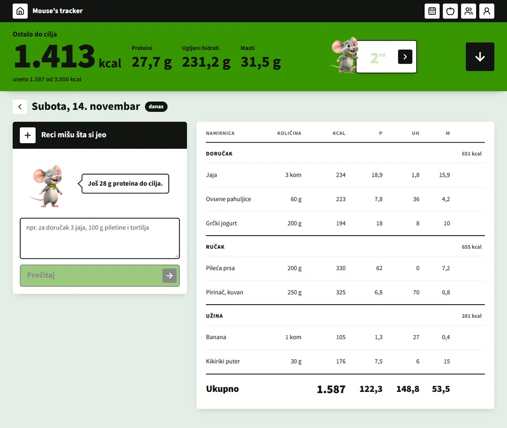

- Runs in the browser (phone and desktop) and as a Windows app (MSI).
- Log by writing a sentence ("3 eggs and 100 g of chicken for breakfast") or by hand.
- Leaderboard among friends, a calendar and a shared food database.
- No ads and no paid services.

> **The app's interface is in Serbian (Latin script).** This README gives the English meaning of the labels in quotes, for example "Reci mišu šta si jeo" ("Tell the mouse what you ate").
>
> All screenshots here were made with made-up data and accounts (Mika, Laza, Sneza, Nikola, Tara). None of them shows real users' data.

## Contents

1. [How to use it](#how-to-use-it)
2. [Tech stack](#tech-stack)
3. [Run it locally](#run-it-locally)
4. [Project structure and docs](#project-structure-and-docs)

## How to use it

### 1. Sign up and sign in

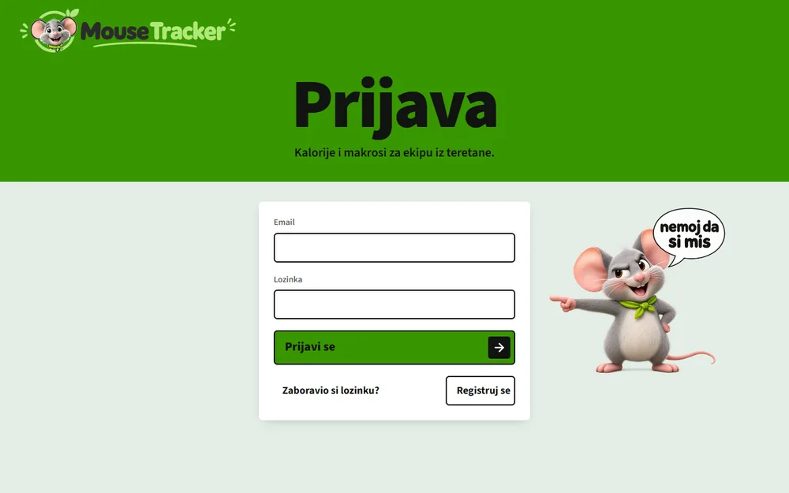

- **Sign up:** a nickname (3–20 characters, friends find you by it), an email and a password (at least 6 characters). An email with a link arrives; click it to confirm your account, then sign in.
- **Sign in:** email and password; the session persists after you close the app.
- **Forgot your password:** "Zaboravio si lozinku?" ("Forgot your password?") sends a code by email; enter it with a new password.

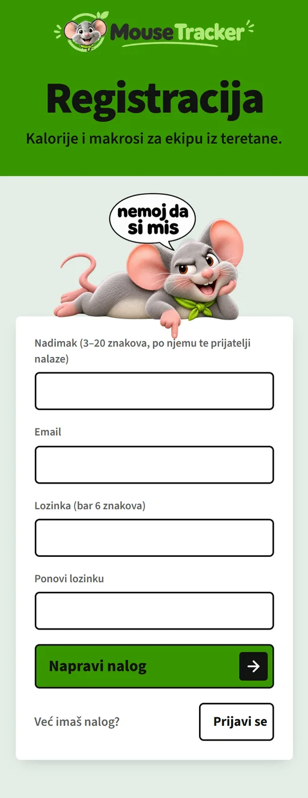

### 2. Profile and daily goal

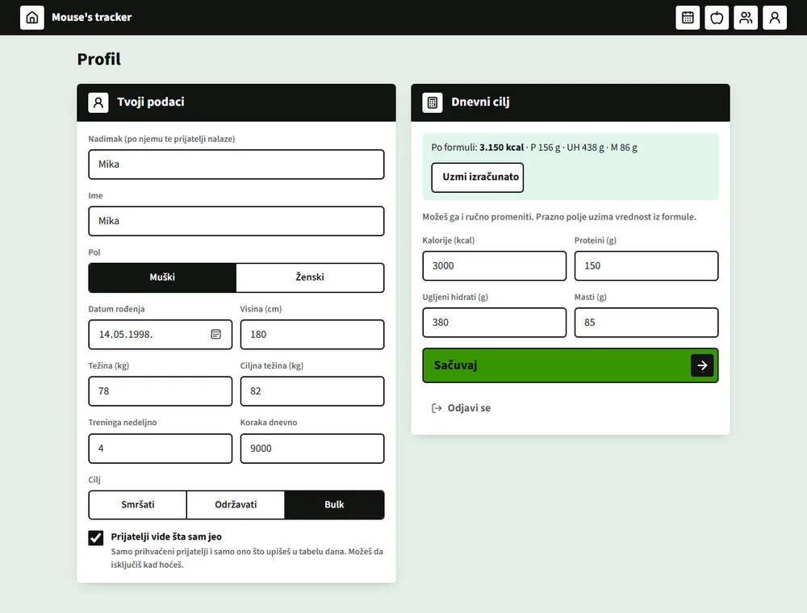

Fill in sex, date of birth, height, weight, workouts per week, steps per day and your goal ("Smršati" lose weight, "Održavati" maintain, or "Bulk"). The app calculates a daily calorie and macro goal with a formula (Mifflin-St Jeor plus activity); click **"Uzmi izračunato"** ("Use the calculated values") or change them by hand. An empty goal field takes the formula's value. Until the profile is complete, the profile icon shows a red dot.

### 3. "Reci mišu šta si jeo" (Tell the mouse what you ate)

The fastest way to log. Write what you ate the way you would tell a friend: *"3 eggs and 60 g of oats for breakfast, 200 g of chicken for lunch"* (in Serbian), then click **"Pročitaj"** ("Read"). The mouse (an AI on the server) reads the message and shows a review before anything is saved:

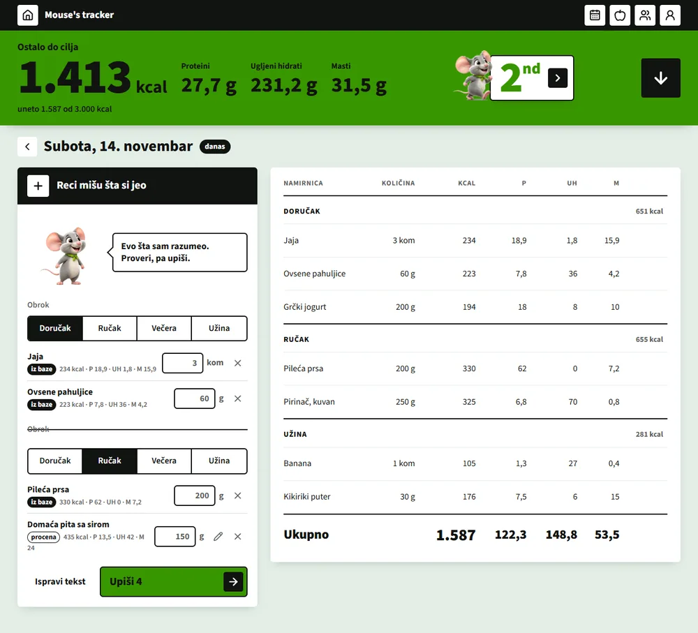

- **Meal:** if you did not say which one, pick it in the review (breakfast, lunch, dinner, snack). "Upiši" ("Save") stays locked until a meal is chosen.
- **"iz baze"** ("from the database") means the food comes from the shared database and its values apply. **"procena"** ("estimate") is the AI's estimate; use the pencil to correct kcal, protein, carbs and fat.
- Change the amount in the field, **X** removes a row, **"Ispravi tekst"** ("Fix the text") goes back to writing.
- **"Upiši N"** ("Save N") puts everything into the day table.
- A message can be up to 500 characters, with 40 readings per user per day. If it fails, you can always log by hand.

### 4. Manual entry (+)

Click **+** in the panel header: pick a meal, search for a food (our database first; the **"Traži na Open Food Facts"** ("Search Open Food Facts") button searches a large public database), check the values, enter the amount and click **"Dodaj"** ("Add"). If the food is nowhere to be found, create a new one (name, unit 100 g or piece, kcal, protein, carbs, fat). **"Gotov doručak"** ("Breakfast done", or lunch, dinner, snack) closes the meal. The message icon takes you back to writing to the mouse.

### 5. The day table

- The green band at the top shows **how much is left to your goal** (kcal, protein, carbs, fat) and how much you have logged.
- Entries are grouped by meal, with a subtotal for each meal and a total for the day.
- The pencil changes the amount, the bin deletes a row. For an estimate the pencil also edits the values, and the **"U bazu"** ("To the database") button sends the estimate to the shared database, so next time the mouse picks it up as "iz baze".
- The arrows move to the previous or next day; past days are edited the same way as today.
- On a phone the entry panel sits above the table, and meals collapse when you tap their title.

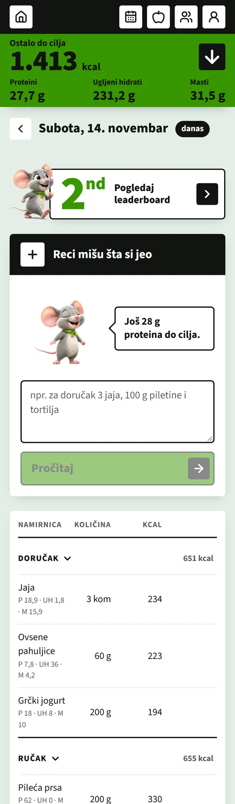

### 6. Calendar

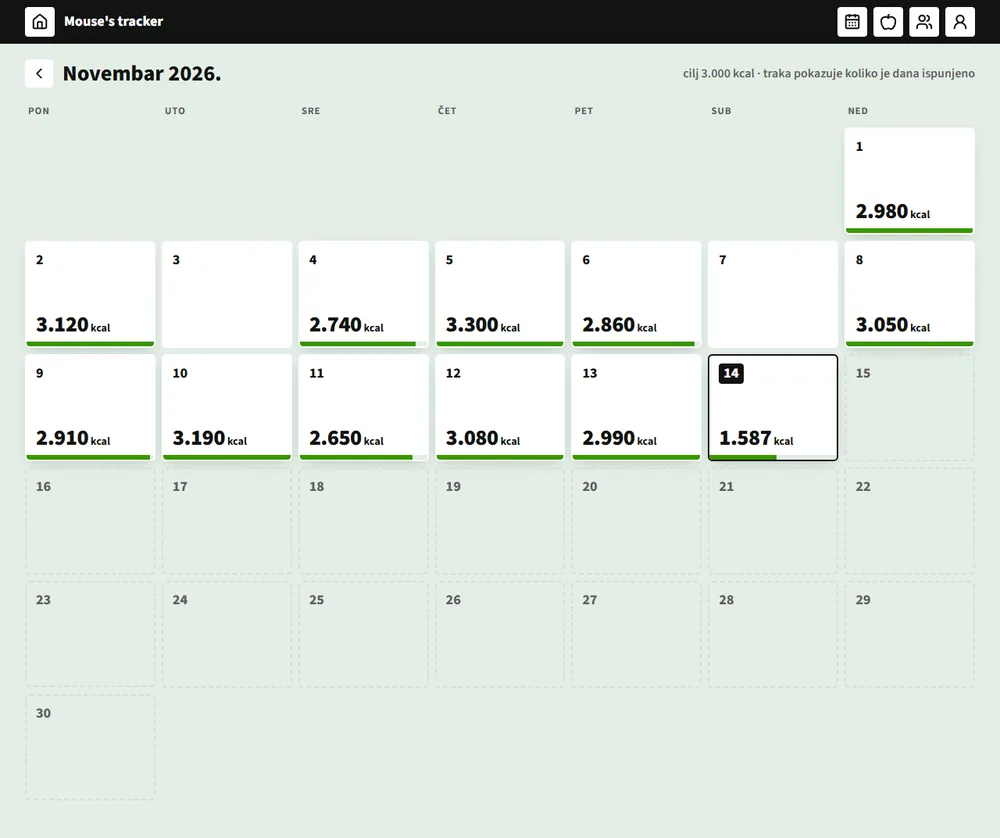

A full-screen month: each day shows the kcal logged and a bar for how much of the goal was met. Click a day to open it.

### 7. Namirnice (Foods)

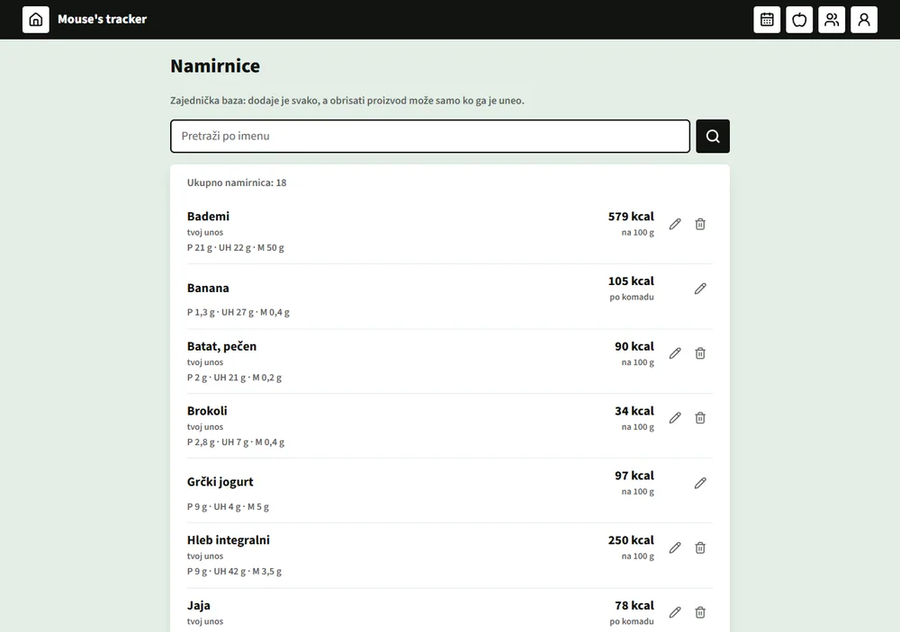

The shared database that everyone fills in. You search by name, fix values with the pencil (anyone can edit, and the database remembers who changed it last), and delete only the foods you added yourself. Old entries stay untouched, because they keep a copy of the values.

### 8. Friends and the leaderboard

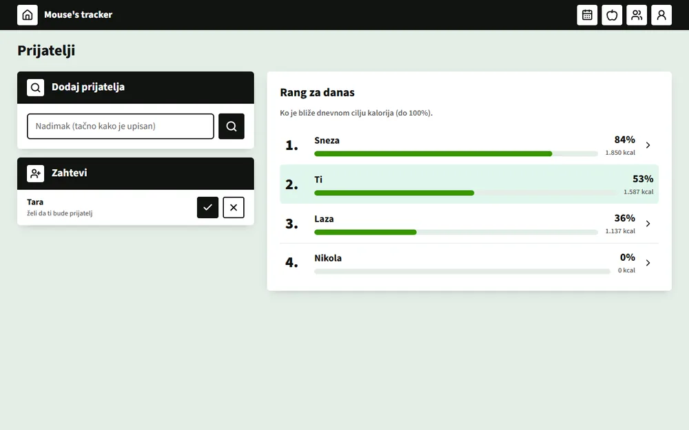

- **"Dodaj prijatelja"** (Add a friend): enter the nickname exactly as it was written (search never lists users). The recipient sees the request under **"Zahtevi"** (Requests) and accepts (✓) or declines (✗).
- **"Rang za danas"** (Today's ranking): you and your accepted friends, ordered by who is closer to their daily calorie goal (capped at 100%). The mouse celebrates when you are first and is angry when you have logged nothing.

### 9. A friend's profile and sharing your entries

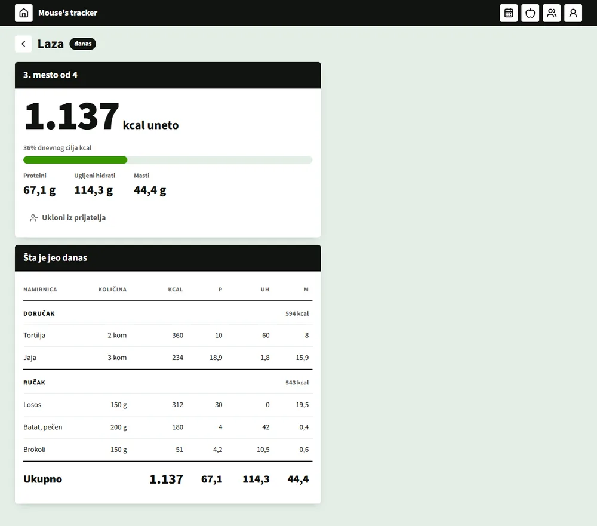

Click a friend to open their profile: their place on the leaderboard, today's calories, percentage of goal and macros, and below it **"Šta je jeo danas"** ("What they ate today"), a read-only table of entries by meal.

- A friend sees your entries **only if you turn it on yourself**: in Profile, the checkbox **"Prijatelji vide šta sam jeo"** ("Friends can see what I ate"), which is off by default. Turning it off, or ending the friendship, takes effect immediately.
- If a friend does not share, the page says they can turn it on in their own profile.
- **"Ukloni iz prijatelja"** ("Remove from friends") ends the friendship.

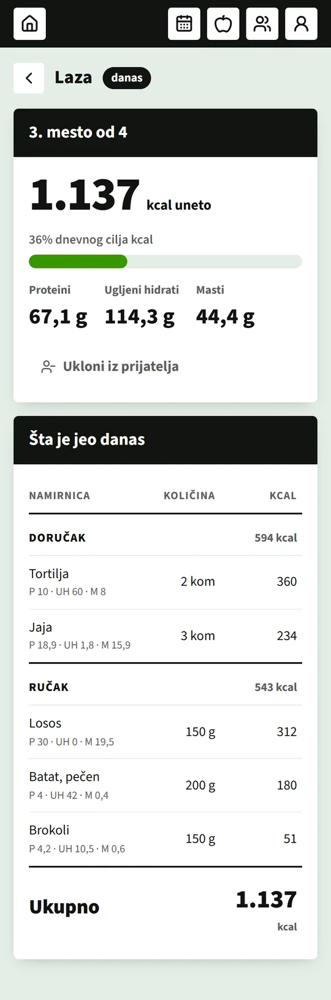

### 10. Desktop app (Windows)

The same program also exists as a Windows app (Tauri). The **MSI** installer is downloaded from the [Releases](https://github.com/Du1eks/food-tracker/releases) page of this repository. It works like the web version, with the same account. Desktop versions lag behind the web, so database changes are always backward compatible.

## Tech stack

| Part | What is used |
|---|---|
| Frontend | React 19, TypeScript, Vite, React Router, lucide icons |
| Database and accounts | Supabase: Postgres with RLS rules (permissions live in the database), Auth (email + password) |
| Logging by sentence | Supabase Edge Function `razumi-obrok` + Google Gemini (free tier); the key is a server-side secret, never in the app |
| Foods | a shared table + Open Food Facts (public API, no key) |
| Desktop | Tauri v2 (Windows, WebView2), MSI installer |
| Hosting | Vercel (web) |
| Checks | oxlint, TypeScript, tests with no extra libraries (`npm test`) |

The same React code is built for both web and desktop; there is no custom server and no paid services are used.

## Run it locally

You need **Node.js 22.18 or newer** and a free [Supabase](https://supabase.com) project.

```bash
git clone https://github.com/Du1eks/food-tracker.git
cd food-tracker
npm install
```

**1. Configuration (`.env`).** Copy `.env.example` to `.env` and fill in the values from your Supabase project (Project Settings → Data API for the URL, API Keys for the *publishable* key):

```bash
cp .env.example .env
```

```
VITE_SUPABASE_URL=https://<your-project>.supabase.co
VITE_SUPABASE_PUBLISHABLE_KEY=sb_publishable_...
```

Only the *publishable* key goes into `.env`. The secret key never goes into the frontend, and `.env` is in `.gitignore`.

**2. Database.** Link the project and apply the migrations from `supabase/migrations` (tables, permissions, friends, entry sharing):

```bash
npx supabase login
npx supabase link --project-ref <your-project>
npx supabase db push --remote
```

**3. Logging by sentence (optional).** Without this everything works except "Reci mišu šta si jeo"; manual entry (+) remains. Get a free Gemini key in Google AI Studio and set it as a Supabase secret:

```bash
npx supabase secrets set GEMINI_API_KEY=<your-key>
npx supabase functions deploy razumi-obrok
```

**4. Run it.**

```bash
npm run dev
```

The app is at the address Vite prints (usually `http://localhost:5173`). Register an account and follow the steps in [How to use it](#how-to-use-it).

Other commands:

| Command | What it does |
|---|---|
| `npm test` | tests (nutrition, ranking, checking the AI response) |
| `npm run lint` | oxlint |
| `npm run build` | type check and a production build into `dist/` |
| `npm run tauri dev` | desktop app in development (needs Rust and the [Tauri prerequisites](https://v2.tauri.app/start/prerequisites/)) |
| `npm run tauri build` | builds the Windows MSI |

## Project structure and docs

```
src/pages/        screens (day, calendar, foods, friends, profile, sign-in)
src/components/   day table, mouse-assisted entry, mascot, app frame
src/lib/          pure logic (nutrition, ranking), database calls (podaci.ts)
supabase/         migrations (database and permissions) and the razumi-obrok Edge Function
src-tauri/        desktop app (Tauri)
docs/             design-decision docs and the images for this README
```

Decisions and explanations (in Serbian) are in `docs/`: [architecture](docs/arhitektura.md), [data model](docs/model.md), [permissions and privacy](docs/dozvole.md), [API](docs/api.md), [screens](docs/ekrani.md), [scaling](docs/skaliranje.md). The design is described in [DESIGN.md](DESIGN.md) and the product in [PRODUCT.md](PRODUCT.md). The project is also a learning exercise in system design, so every larger decision is briefly explained.
