# Mouse's tracker

**Srpski** · [English](README.en.md)

Mala, besplatna aplikacija za praćenje kalorija i makrosa (proteini, ugljeni hidrati, masti), napravljena za ekipu iz teretane. Napišeš mišu šta si jeo, on to pretvori u unose, a aplikacija sabira dan i pokazuje koliko je ostalo do dnevnog cilja. Namirnice su zajedničke i dopunjuju ih svi zajedno, a obroci su privatni, osim ako sam odlučiš da ih podeliš sa prijateljima.

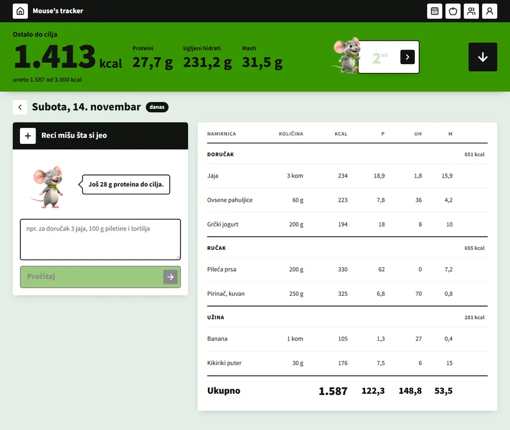

- Radi u pregledaču (telefon i računar) i kao Windows aplikacija (MSI).
- Unos rečenicom ("za doručak 3 jaja i 100 g piletine") ili ručno.
- Rang lista među prijateljima, kalendar i zajednička baza namirnica.
- Bez reklama i bez plaćenih servisa. Ceo korisnički tekst je na srpskom (latinica).

> Sve slike u ovom README-u su napravljene sa izmišljenim podacima i nalozima (Mika, Laza, Sneza, Nikola, Tara). Ni na jednoj nema podataka stvarnih korisnika.

## Sadržaj

1. [Kako se koristi](#kako-se-koristi)
2. [Tehnologije](#tehnologije)
3. [Pokretanje lokalno](#pokretanje-lokalno)
4. [Struktura projekta i dokumentacija](#struktura-projekta-i-dokumentacija)

## Kako se koristi

### 1. Registracija i prijava

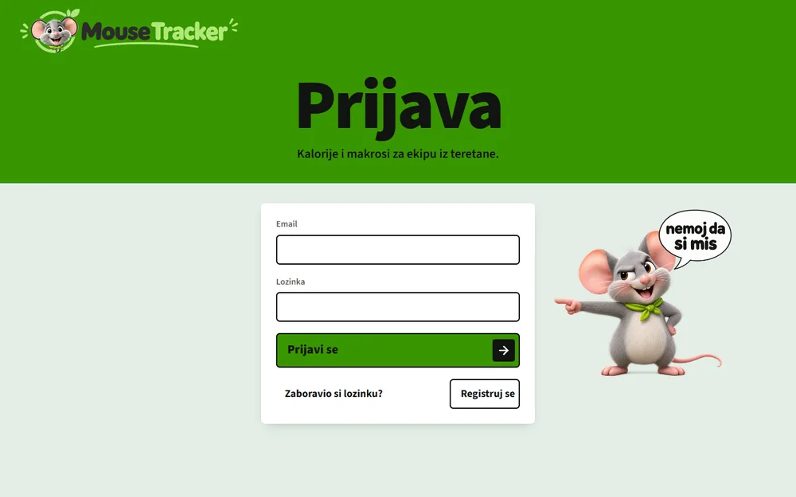

- **Registracija:** nadimak (3–20 znakova, po njemu te prijatelji nalaze), email i lozinka (bar 6 znakova). Na email stiže link; klikni ga da potvrdiš nalog, pa se prijavi.
- **Prijava:** email i lozinka, sesija ostaje i posle zatvaranja.
- **Zaboravljena lozinka:** "Zaboravio si lozinku?" pošalje kod na email; upišeš ga i novu lozinku.

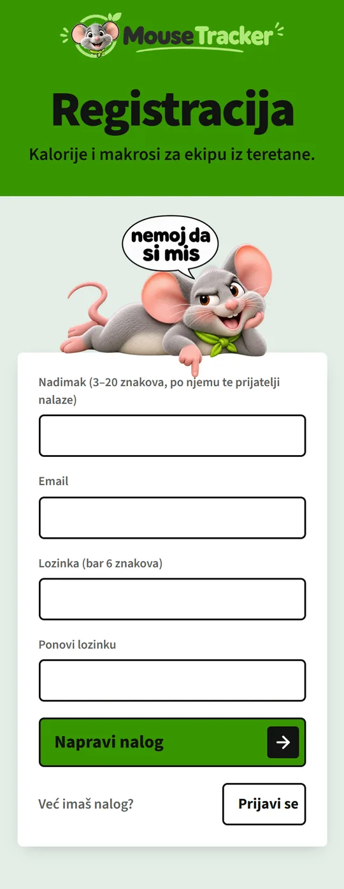

### 2. Profil i dnevni cilj

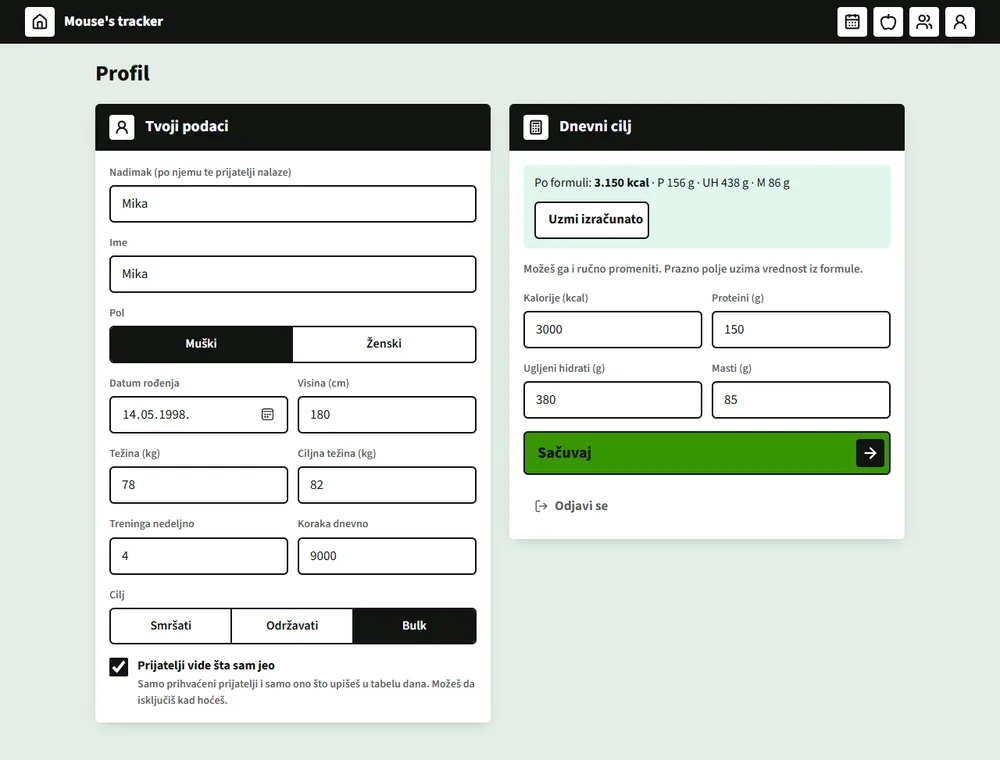

Popuni pol, datum rođenja, visinu, težinu, treninge nedeljno, korake dnevno i cilj (smršati, održavati ili bulk). Aplikacija po formuli (Mifflin-St Jeor uz aktivnost) izračuna dnevni cilj u kalorijama i makroima; klikni **"Uzmi izračunato"** ili ga ručno promeni. Prazno polje cilja uzima vrednost iz formule. Dok profil nije popunjen, na ikoni profila gori crvena tačka.

### 3. "Reci mišu šta si jeo"

Najbrži način unosa. Napiši šta si jeo, kao što bi rekao drugu: *"za doručak 3 jaja i 60 g ovsenih pahuljica, za ručak 200 g piletine"*, pa klikni **"Pročitaj"**. Miš (AI na serveru) pročita poruku i prikaže pregled pre nego što se išta upiše:

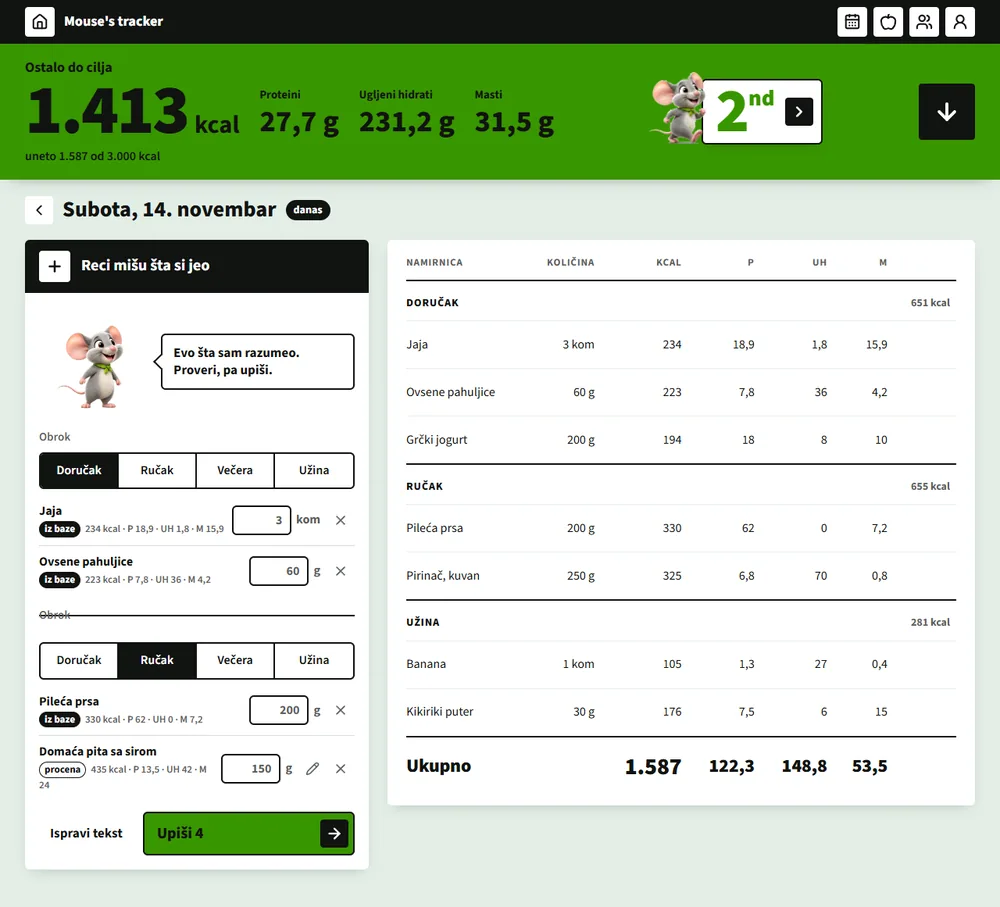

- **Obrok:** ako ga nisi napisao, izaberi ga u pregledu (doručak, ručak, večera, užina). Dok obrok nije izabran, "Upiši" je zaključano.
- **"iz baze"** znači da je namirnica iz zajedničke baze i važe njene vrednosti. **"procena"** je procena AI-ja; olovkom ispraviš kcal, proteine, UH i masti.
- Količinu menjaš u polju, **X** izbacuje red, **"Ispravi tekst"** vraća na pisanje.
- **"Upiši N"** stavlja sve u tabelu dana.
- Poruka može imati najviše 500 znakova, a dnevno ima 40 čitanja po korisniku. Kad ne uspe, uvek možeš ručno.

### 4. Ručni unos (+)

Klikni **+** u zaglavlju panela: izaberi obrok, pretraži namirnicu (prvo naša baza, a dugme **"Traži na Open Food Facts"** traži u velikoj javnoj bazi), proveri vrednosti, upiši količinu i klikni **"Dodaj"**. Ako namirnice nigde nema, napraviš novu (ime, jedinica 100 g ili komad, kcal, proteini, UH, masti). **"Gotov doručak"** (ili ručak, večera, užina) zatvara obrok. Ikonica sa porukom vraća na pisanje mišu.

### 5. Tabela dana

- Zeleni deo gore pokazuje **koliko je ostalo do cilja** (kcal, proteini, UH, masti) i koliko si uneo.
- Unosi su grupisani po obroku, sa zbirom obroka i ukupnim zbirom za dan.
- Olovka menja količinu, korpa briše red. Kod procene olovka menja i vrednosti, a dugme **"U bazu"** šalje procenu u zajedničku bazu, pa je sledeći put miš uzima kao "iz baze".
- Strelicama pređeš na prethodni ili sledeći dan; prošli dani se menjaju isto kao današnji.
- Na telefonu je unos iznad tabele, a obroci se skupljaju klikom na naslov.

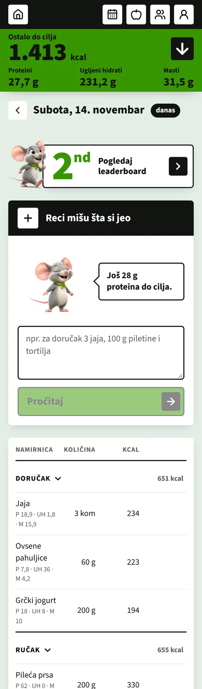

### 6. Kalendar

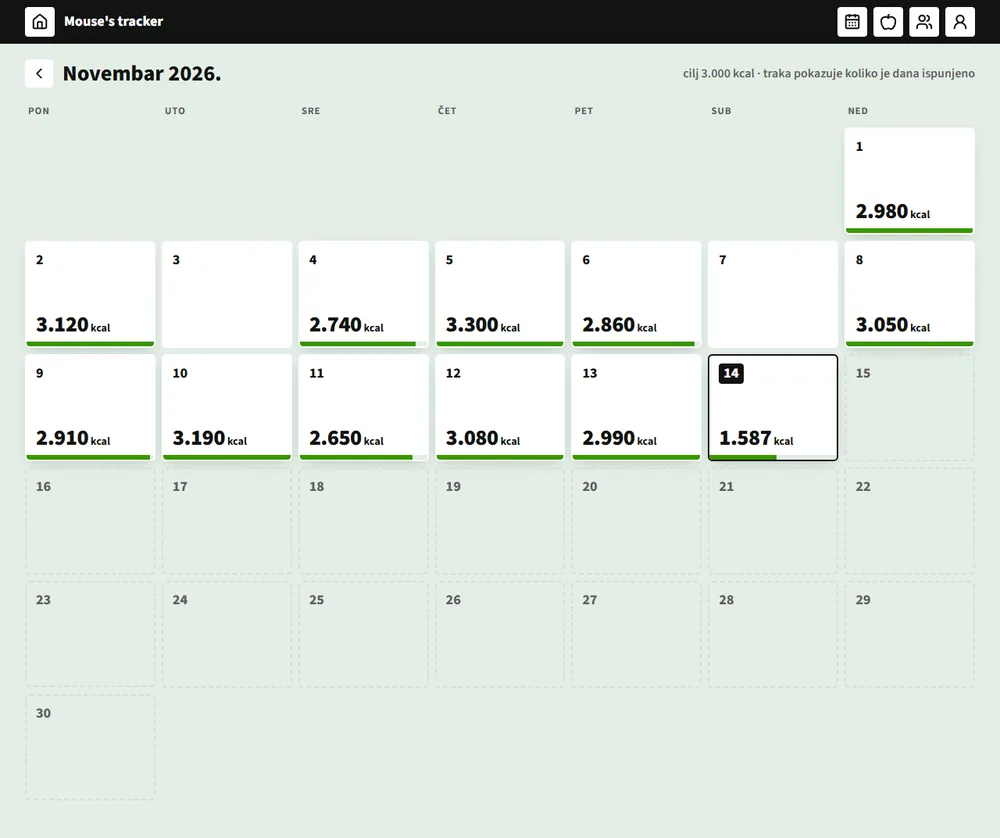

Mesec preko celog ekrana: svaki dan pokazuje uneto kcal i traku koliko je dana cilj ispunjen. Klik na dan otvara taj dan.

### 7. Namirnice

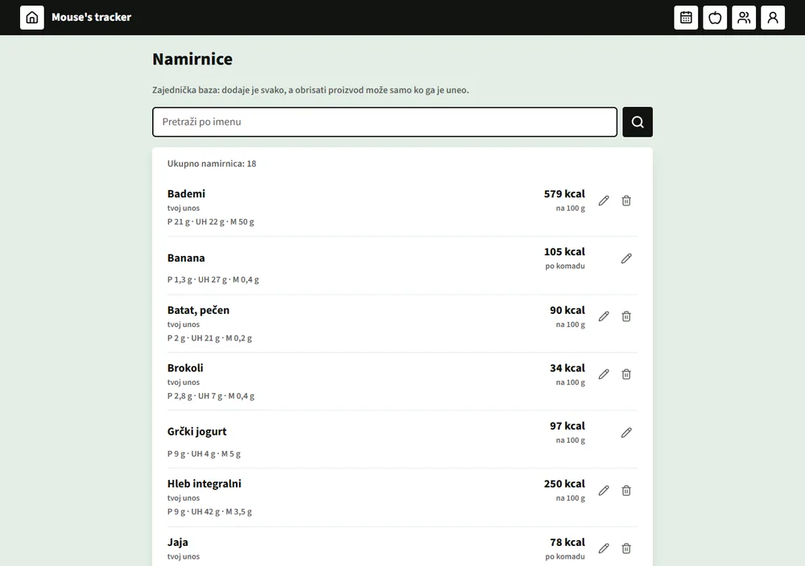

Zajednička baza koju svi pune. Pretražuješ po imenu, olovkom ispravljaš vrednosti (menja ih svako, a baza pamti ko je poslednji), a korpom brišeš samo namirnice koje si ti uneo. Stari unosi ostaju netaknuti jer čuvaju kopiju vrednosti.

### 8. Prijatelji i rang lista

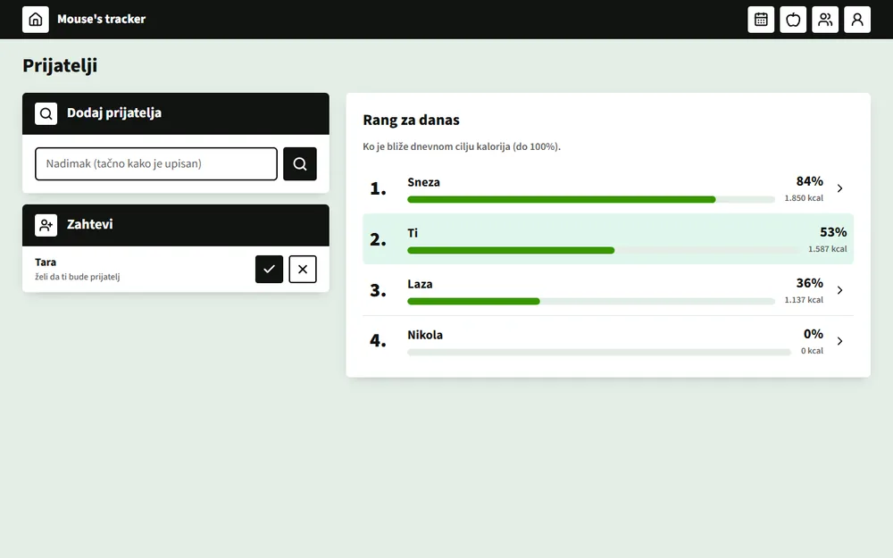

- **Dodaj prijatelja:** upiši nadimak tačno kako je upisan (pretraga ne izlistava korisnike). Primalac vidi zahtev pod **"Zahtevi"** i prihvata ga (✓) ili odbija (✗).
- **Rang za danas:** ti i prihvaćeni prijatelji, poređani po tome ko je bliži dnevnom cilju kalorija (do 100%). Miš slavi kad si prvi, a ljut je kad nisi uneo ništa.

### 9. Profil prijatelja i deljenje unosa

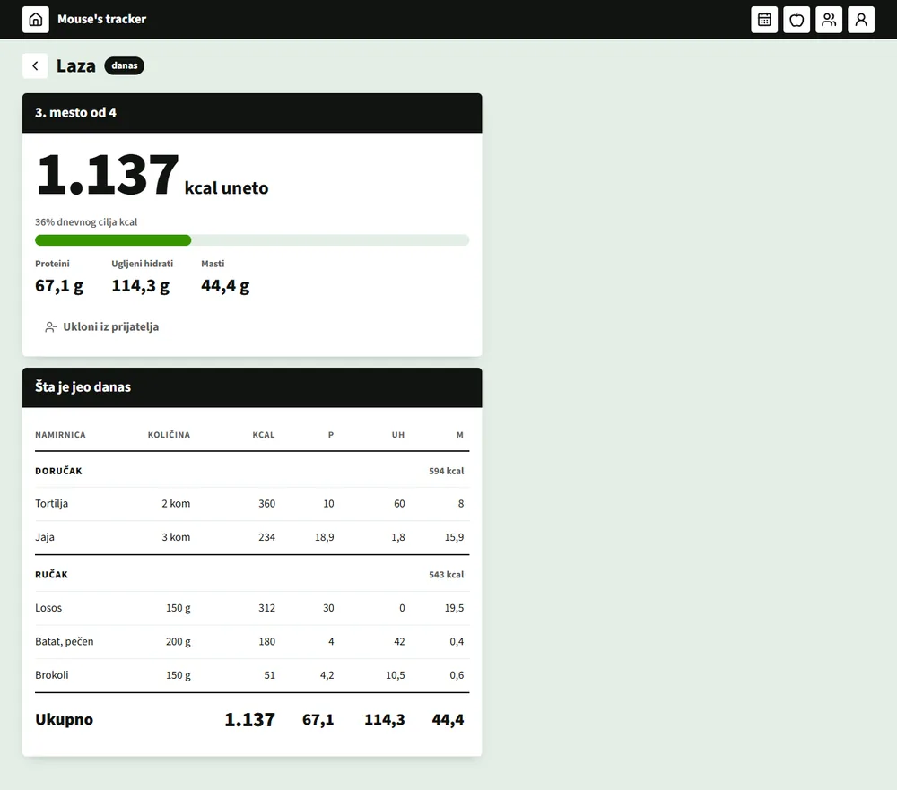

Klik na prijatelja otvara njegov profil: mesto na rang listi, današnje kalorije, procenat cilja i makroi, a ispod **"Šta je jeo danas"**, tabela unosa po obrocima (samo za čitanje).

- Prijatelj vidi tvoje unose **samo ako to sam uključiš**: u Profilu kvačica **"Prijatelji vide šta sam jeo"** (podrazumevano je isključena). Isključivanje i ukidanje prijateljstva važe odmah.
- Ako prijatelj ne deli, piše da to može da uključi u svom profilu.
- **"Ukloni iz prijatelja"** ukida prijateljstvo.

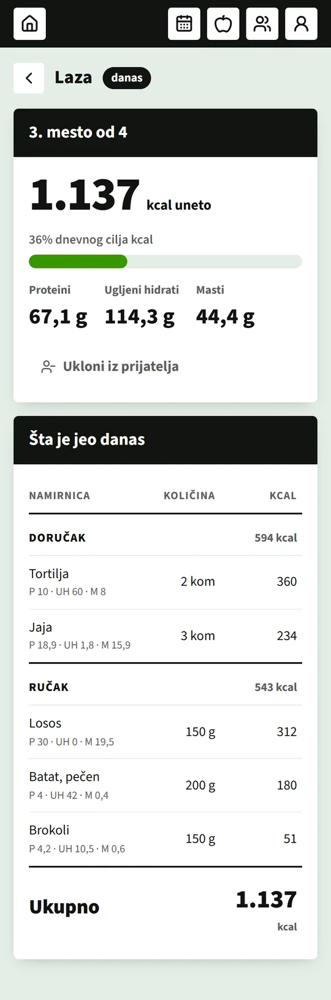

### 10. Desktop aplikacija (Windows)

Isti program postoji i kao Windows aplikacija (Tauri). Instalacioni **MSI** se preuzima sa stranice [Releases](https://github.com/Du1eks/food-tracker/releases) ovog repoa. Radi isto kao web verzija, sa istim nalogom. Desktop verzije kasne za webom, pa se promene baze uvek prave unazad kompatibilno.

## Tehnologije

| Deo | Šta se koristi |
|---|---|
| Frontend | React 19, TypeScript, Vite, React Router, lucide ikonice |
| Baza i nalozi | Supabase: Postgres sa RLS pravilima (dozvole su u bazi), Auth (email + lozinka) |
| Unos rečenicom | Supabase Edge Function `razumi-obrok` + Google Gemini (besplatni nivo); ključ je serverska tajna, nikad u aplikaciji |
| Namirnice | zajednička tabela + Open Food Facts (javni API, bez ključa) |
| Desktop | Tauri v2 (Windows, WebView2), MSI instalacija |
| Hosting | Vercel (web) |
| Provere | oxlint, TypeScript, testovi bez dodatnih biblioteka (`npm test`) |

Isti React kod se gradi i za web i za desktop; nema sopstvenog servera, a plaćeni servisi se ne koriste.

## Pokretanje lokalno

Potrebno: **Node.js 22.18 ili noviji** i besplatan [Supabase](https://supabase.com) projekat.

```bash
git clone https://github.com/Du1eks/food-tracker.git
cd food-tracker
npm install
```

**1. Podešavanje (`.env`).** Kopiraj `.env.example` u `.env` i upiši vrednosti iz svog Supabase projekta (Project Settings → Data API za adresu, API Keys za *publishable* ključ):

```bash
cp .env.example .env
```

```
VITE_SUPABASE_URL=https://<tvoj-projekat>.supabase.co
VITE_SUPABASE_PUBLISHABLE_KEY=sb_publishable_...
```

Samo *publishable* ključ ide u `.env`. Tajni (*secret*) ključ nikad ne ide u frontend, a `.env` je u `.gitignore`.

**2. Baza.** Poveži projekat i primeni migracije iz `supabase/migrations` (tabele, dozvole, prijatelji, deljenje unosa):

```bash
npx supabase login
npx supabase link --project-ref <tvoj-projekat>
npx supabase db push --remote
```

**3. Unos rečenicom (opciono).** Bez ovoga sve radi, osim "Reci mišu šta si jeo"; ručni unos (+) ostaje. Ključ za Gemini uzmi besplatno u Google AI Studio i postavi ga kao Supabase tajnu:

```bash
npx supabase secrets set GEMINI_API_KEY=<tvoj-kljuc>
npx supabase functions deploy razumi-obrok
```

**4. Pokretanje.**

```bash
npm run dev
```

Aplikacija je na adresi koju Vite ispiše (obično `http://localhost:5173`). Registruj nalog i prati korake iz odeljka [Kako se koristi](#kako-se-koristi).

Ostale komande:

| Komanda | Šta radi |
|---|---|
| `npm test` | testovi (ishrana, rang, provera AI odgovora) |
| `npm run lint` | oxlint |
| `npm run build` | provera tipova i produkcioni build u `dist/` |
| `npm run tauri dev` | desktop aplikacija u razvoju (treba Rust i [Tauri preduslovi](https://v2.tauri.app/start/prerequisites/)) |
| `npm run tauri build` | pravi Windows MSI |

## Struktura projekta i dokumentacija

```
src/pages/        ekrani (dan, kalendar, namirnice, prijatelji, profil, prijava)
src/components/   tabela dana, unos preko miša, maskota, okvir
src/lib/          čista logika (ishrana, rang), pozivi baze (podaci.ts)
supabase/         migracije (baza i dozvole) i Edge Function razumi-obrok
src-tauri/        desktop aplikacija (Tauri)
docs/             dokumentacija odluka i slike za ovaj README
```

Odluke i objašnjenja (na srpskom) su u `docs/`: [arhitektura](docs/arhitektura.md), [model podataka](docs/model.md), [dozvole i privatnost](docs/dozvole.md), [API](docs/api.md), [ekrani](docs/ekrani.md), [skaliranje](docs/skaliranje.md). Dizajn je opisan u [DESIGN.md](DESIGN.md), a proizvod u [PRODUCT.md](PRODUCT.md). Projekat je ujedno i vežba za učenje system design-a, pa je svaka veća odluka kratko objašnjena.
