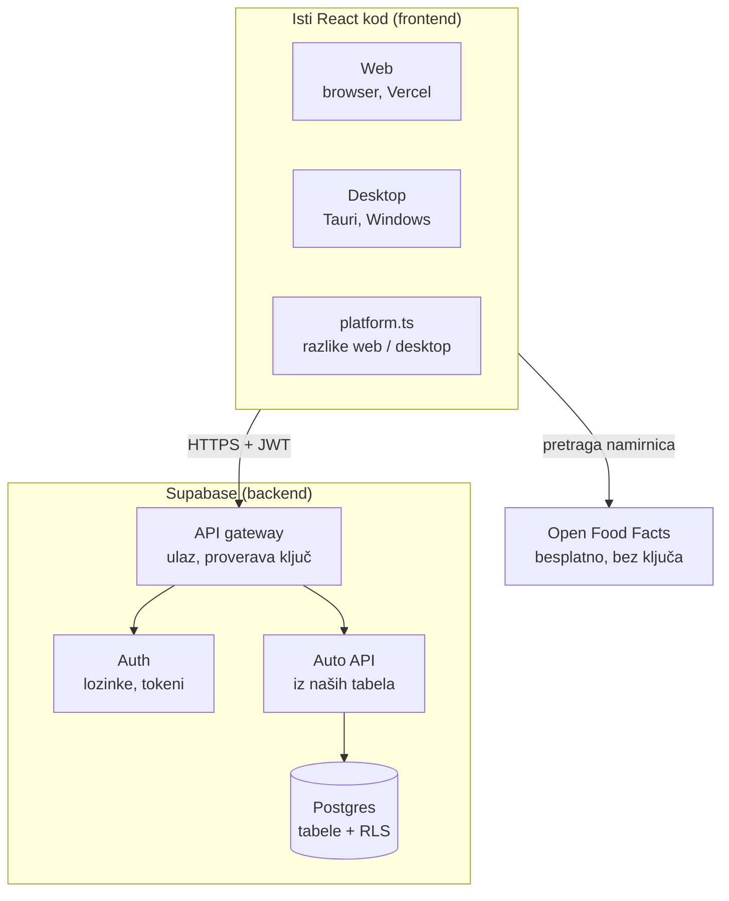

# Arhitektura (Korak 3)

## Tok zahteva ("daj današnje unose")
1. React (web ili desktop) šalje zahtev sa JWT tokenom.
2. Gateway prosleđuje; Auto API pravi SQL (`select * from unos where datum = ...`).
3. Postgres primenjuje RLS (`korisnik_id = auth.uid()`) i vraća samo redove tog korisnika.

## Odluke
- **Jedan backend, više klijenata**: web i desktop su isti React build; razlike (linkovi, sesija) samo u `platform.ts`.
- **Supabase kao backend (BaaS)**: nema našeg servera; dozvole su RLS pravila u bazi, ne kod u frontendu.
- **Login**: email + lozinka; sesija ostaje (access token ~1 h + refresh token u `localStorage`).
- **Open Food Facts** se zove direktno iz React-a: besplatno i bez ključa, pa nema šta da se krije na serveru.
- **Edge Functions** samo ako zatreba logika koja ne sme u browser. Plaćeni servisi se ne koriste.
- **Desktop verzije kasne za webom**: izmene baze moraju biti kompatibilne unazad (dodaj kolonu, ne briši/preimenuj odmah).
