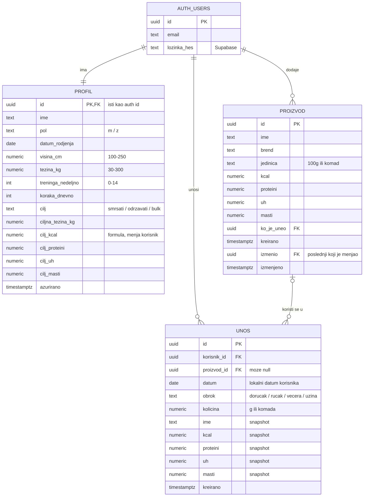

# Model podataka (Korak 2)

## Odluke
- **Korisnici** su Supabase `auth.users` (email, hešovana lozinka); `profil` je 1:1 sa njima.
- **Proizvodi su zajednički** (samo ulogovani korisnici): svi čitaju, dodaju i menjaju; briše samo `ko_je_uneo`. `izmenio`/`izmenjeno` pamte poslednju izmenu.
- **Unosi su privatni**: RLS dozvoljava samo `korisnik_id = auth.uid()`. Isto važi za `profil`.
- **Snapshot**: unos kopira ime i vrednosti (već izračunate za količinu), pa izmena proizvoda ne menja istoriju, a dnevni zbir je prost `SUM`.
- **Datum** šalje app (lokalni datum korisnika), ne server.
- **Datum rođenja umesto godina**: ne čuvamo izvedene podatke koji zastarevaju.
- **Dnevni cilj** se čuva u profilu (popunjava formula Mifflin-St Jeor, korisnik može ručno da promeni). Bez istorije ciljeva u MVP-u.
- **Obrok** je kolona u `unos`, ne zasebna tabela.
- `CHECK` ograničenja u bazi odbijaju besmislene vrednosti.
